# busybar-calendar

Calendar reminders for the [BUSY Bar](https://busy.app) from **any CalDAV
account or ICS feed**, in four screen designs.

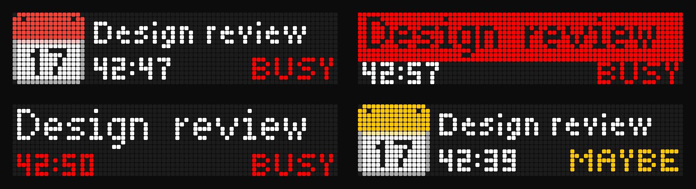

The bar's own [Google Calendar integration](https://docs.busy.app/bar/apps-and-integrations/google-calendar)
runs in BUSY Cloud and only talks to Google. This does the same thing for
iCloud, Fastmail, Nextcloud, PrivateEmail, self-hosted CalDAV servers, and
any calendar published as an ICS link (Outlook, Google, Proton). It runs on
a machine of yours and draws through the bar's
[HTTP API](https://docs.busy.app/bar/dev/http-api), via BUSY Cloud or on the
LAN. The default design looks the same as Google's events; only where they come
from is different. Requested upstream as
[busybar-firmware#1086](https://github.com/busy-app/busybar-firmware/issues/1086).

## Screen designs

Every picture here is a frame read back from a real bar (firmware 1.2.4)
through `GET /api/screen`; the one at the top is four of them side by side.

`busybar-calendar init` asks which design to draw. The first, the default, is what
you get if you do not choose. To change it later, set `layout` under `[display]`;
the running service applies it within a minute.

### 1. Default

The calendar icon, the title, a countdown that ticks on the bar, and BUSY while
the event runs. A Maybe gets a yellow calendar and a yellow BUSY.

| Before the event | During the event | Marked "Maybe" |
| --- | --- | --- |
| 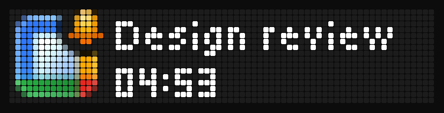 |  | 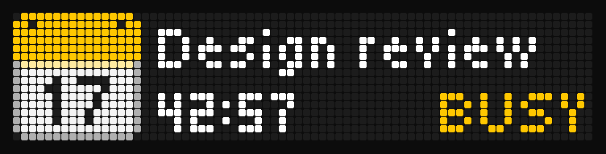 |

### 2. Banner (`layout = "banner"`)

The title on a band of the state colour: white before the start, red during an
event you accepted, and a yellow outline with a yellow title for a Maybe. The
countdown and BUSY sit below.

| Before the event | During the event | Marked "Maybe" |
| --- | --- | --- |
| 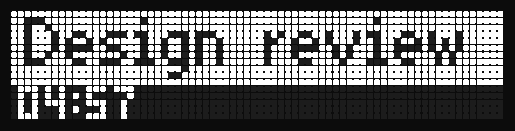 | 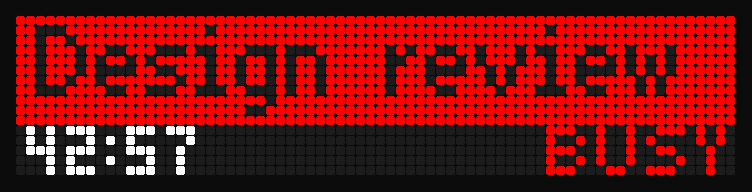 | 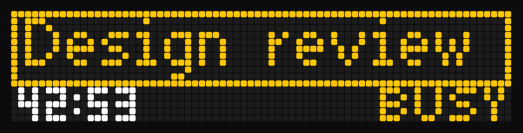 |

The filled red band has black lettering, which reads best close up. The hollow
Maybe band reads best from a distance.

### 3. Bold title (`layout = "bold_title"`)

The title in the larger 7 px font across the top, and the countdown and the label
below it in the state colour: white before the start, red when accepted. A Maybe is
yellow and says MAYBE. There is no icon.

| Before the event | During the event | Marked "Maybe" |
| --- | --- | --- |
| 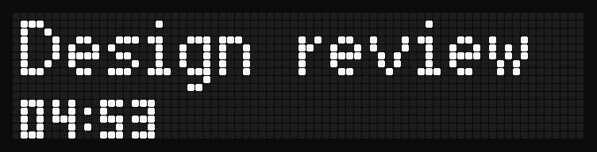 | 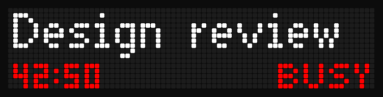 | 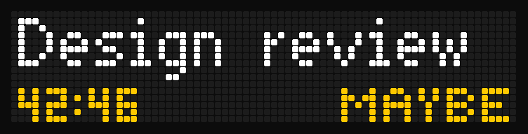 |

### 4. Words (`layout = "words"`)

The default look with the response in words: a Maybe says MAYBE where BUSY would be,
and already does in its reminder, so it reads without relying on colour.

| Before the event | During the event | Marked "Maybe" |
| --- | --- | --- |
| 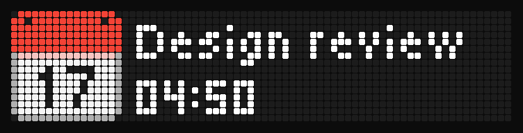 | 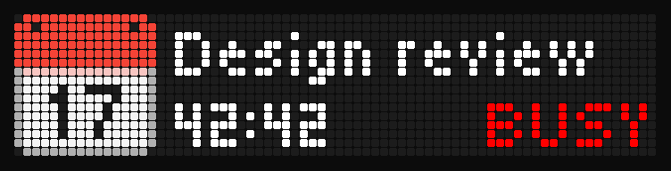 | 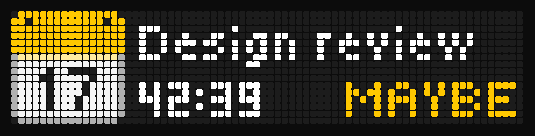 |

### What they share

- The countdown ticks on the bar itself in all four, so nothing is sent each second.
- Banner and Bold title draw the title in the 7 px font (the 11 px `global` font with
  `title_font = "global"`) and have no icon, so `title_font = "small"`,
  `reminder_icon` and `event_icon` do not apply to them.
- A title that does not fit scrolls, in every design. In the new ones it is scrolled
  only when its real width does not fit.
- `tentative_yellow = false` draws a Maybe like an accepted event in every design.
- A status such as `meeting` is drawn the same in every design.
- The three extra designs were picked from ten whole-screen concepts, each scored on
  legibility, how well it tells a Maybe from an accepted event (also for red-green
  colour blindness), information, stress cases, load on the panel and effort to run.
  Those scoring over 70 of 100 were kept.

## The rest of the screen

These pictures show the default design.

| | |
| --- | --- |
| One of the bar's own statuses, such as `meeting`, `on_call` or `dnd`, instead of the event name. |  |
| **Long titles** scroll beside the icon. |  |
| **Titles in other scripts** are transliterated for the bar's bitmap fonts (`Планування спринту` becomes `Planuvannya sprintu`) ... |  |
| ... or drawn as they are with `title_font = "global"`, on one line beside the countdown. |  |
| **Event name hidden** for a calendar (`show_name = false`). |  |

Like Google events, these go in above an active BUSY session, so they show
on top of any status. A sound plays as a reminder opens and as an event
starts, using the bar's own calendar sounds. After the event, the bar goes
back to whatever it was showing.

## Features

- **CalDAV** with discovery (`/.well-known/caldav`, principal, calendar home),
  or a calendar URL directly; Basic or Digest auth.
- **Calendar filters**: `include` / `exclude` by name, id or URL, with
  wildcards (`exclude = ["Room *"]`).
- **ICS / webcal** feeds, fetched with `If-None-Match`.
- **Recurring events** expanded locally (RRULE, EXDATE, moved occurrences),
  timezones and floating times handled.
- **Google's per-calendar settings** (reminder time, sound, show name,
  status), set once as defaults and overridden per source or per calendar.
- **Rules by title**, from any calendar: keep `Focus time` off the bar,
  show `Lunch*` as the bar's own lunch status.
- **Overlaps settled by your response**: an event you accepted wins over
  one you marked tentative, which wins over one you have not answered - when
  they start together and when they are shifted against each other, so a
  "maybe" never covers a meeting you said yes to; then, as in Google's
  integration, the newest event wins.
- **A Maybe you can tell**: an event you marked tentative is yellow in every
  design (`display.tentative_yellow`, default on), and three of the designs add a
  shape or a word so colour is not the only cue.
- **Four screen designs**, chosen in `init` or with `display.layout`; see above.
- **Google's filters**: no all-day or 24-hour-plus events. Also skipped:
  cancelled events, events marked free, invitations you declined.
- **On time**: the loop wakes at the next change, not on the next poll.
- **Live config**: the running service applies an edited config within a
  minute; an edit that does not load is left out, and the log says why.
- **Resilient**: a failing source keeps its last good events; a bar that
  cannot be reached is retried; drawings expire on the bar by themselves
  if the service stops.
- **No secrets in files**: passwords and tokens come from the environment
  or a command such as the macOS Keychain.

## Get started

```sh
uv tool install git+https://github.com/kurok/busybar-calendar
busybar-calendar init     # a few questions: how to reach the bar, which calendar
busybar-calendar check    # proves it works, or says what to fix
busybar-calendar install  # runs it in the background from now on
```

`init` asks how to reach the bar (BUSY Cloud, Wi-Fi or USB) and which
calendar to read, keeps the passwords in the macOS Keychain (libsecret on
Linux), signs in so you can pick calendars, asks which screen design to draw, and
writes `~/.config/busybar-calendar/config.toml`. To write the config yourself,
start from [`config.example.toml`](config.example.toml).

## Everyday commands

| Command | |
| --- | --- |
| `busybar-calendar` | Where you stand: the first steps before setup, the status after. |
| `busybar-calendar status` | Is it running, what did it last log, what is on the bar now and next. |
| `busybar-calendar check` | The bar, its token and every calendar, with what to fix. |
| `busybar-calendar add` | Another calendar, by the same questions as `init`. |
| `busybar-calendar restart` | After a new password or a `[bar]` change; other config edits apply by themselves within a minute. |
| `busybar-calendar upcoming` | The events the bar will show, and when; tentative ones marked. |
| `busybar-calendar calendars` | What each CalDAV account has, with ids, for `include`. |
| `busybar-calendar replay` | Tomorrow's events on the bar, a minute each, in your design. |
| `busybar-calendar demo` | A sample reminder on the bar, to see the look of your design. |
| `busybar-calendar uninstall` | Stop and remove the background service. |

`status` and `check` also take `--json`, for scripts. A newer version is
`uv tool upgrade busybar-calendar && busybar-calendar restart` - or, with
`busybar-calendar install --auto-update`, the service fetches it by itself
every time it starts or restarts.

## As a BUSY Bar gallery app

`app.py` follows the [community gallery](https://github.com/maxswinkels/busybar-apps)'s
conventions: one entrypoint, `--host` (default `10.0.4.20`, the bar over
USB), secrets from the environment only. It runs from a clone:

```sh
git clone https://github.com/kurok/busybar-calendar.git && cd busybar-calendar
pip install -r requirements.txt
python app.py                        # the config init wrote; a demo schedule before that
python app.py --host 192.168.1.50 --ics "https://example.com/work.ics"
CALDAV_PASSWORD=... python app.py --caldav https://caldav.icloud.com --user me@icloud.com
BUSYBAR_TOKEN=... python app.py --cloud --ics "https://example.com/work.ics"
```

`CALDAV_PASSWORD` is the calendar's password, `BUSYBAR_TOKEN` the bar's HTTP
API password or, with `--cloud`, a BUSY Cloud token. On macOS the first
start after installing the requirements takes a few seconds while the system
checks the new libraries; later starts take a fraction of a second.

## Settings

The per-calendar settings are the Google Calendar integration's:

| Google Calendar integration | `config.toml` |
| --- | --- |
| Event reminders: on/off | `reminder.enabled` |
| How long before the event | `reminder.minutes_before` |
| Sound | `reminder.sound` |
| Show event name | `reminder.show_name` |
| Status during events: on/off | `status.enabled` |
| Event name, or a status from the list | `status.show`: `name`, `meeting`, `on_call`, `dnd`, ... |
| Sound | `status.sound` |
| *(not in Google's)* Busy status for events you marked tentative | `status.tentative` (default on) |
| *(not in Google's)* Yellow calendar and BUSY for events you marked tentative | `display.tentative_yellow` (default on) |
| *(not in Google's)* Which screen design | `display.layout`: `default`, `banner`, `bold_title`, `words` |

They layer: `[defaults]` for every calendar, then per source, then per
calendar (`[sources.calendars."Work".reminder]`); a default set once is the
account-level setting BUSY Cloud does not have yet
([busybar-firmware#1083](https://github.com/busy-app/busybar-firmware/issues/1083)).
Last come the `[[titles]]` rules, which match event titles in any calendar:

```toml
[[titles]]
match = ["Focus time", "Commute*"]   # * and ? are wildcards; case does not matter
reminder.enabled = false
status.enabled = false
```

`[display]` sets the look: the screen design (`layout`, see above), the icons
(`red_calendar` or the bar's own `animation`), the word beside the countdown
(`busy_label`, `busy_color`) and whether events you marked tentative are drawn in
yellow (`tentative_yellow`).
Every option, with its default, is in the
[configuration reference](docs/configuration.md).

## Documentation

- [Setup](docs/setup.md) - the bar, calendar providers, secrets, running as a service.
- [Troubleshooting](docs/troubleshooting.md) - what `check` and `status` say when something is wrong, and the fix.
- [Configuration reference](docs/configuration.md) - every option and its default, generated from the code.
- [Changelog](CHANGELOG.md) - what changed in each version.
- [How it works](docs/how-it-works.md) - the design, the API calls, and what was measured on the hardware.

## Development

```sh
uv sync
uv run pytest
uv run ruff check . && uv run ruff format --check .
```

The tests in `tests/emulator` run the app against the
[BUSY Bar emulator](https://github.com/maxswinkels/busybar-emulator), a bar that rejects
a drawing the firmware would: they draw every design and screen, run the service and the
commands, and check what ends up on the display. CI runs them against
[a pinned commit](.github/workflows/ci.yml) of the emulator. To run them yourself, clone it
(its server has no dependencies, so there is nothing to install) and point the tests at it:

```sh
git clone https://github.com/maxswinkels/busybar-emulator .emulator
BUSYBAR_EMULATOR=.emulator uv run pytest tests/emulator
```

Without `BUSYBAR_EMULATOR` they are skipped, and `-m "not emulator"` leaves them out. They
never touch a real bar or calendar: the emulator listens on loopback, and the app runs in
them with a fresh `HOME`, so it cannot find your config.

`scripts/capture_screens.py` regenerates `docs/images` from a real bar.

## License

MIT, except the red and yellow calendar icons in `src/busybar_calendar/icons.py`:
they are redrawn from Google's [Noto Emoji](https://github.com/googlefonts/noto-emoji)
📅 and stay under the SIL Open Font License 1.1
([LICENSES/noto-emoji-OFL.txt](LICENSES/noto-emoji-OFL.txt)).
