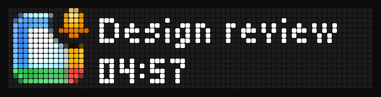
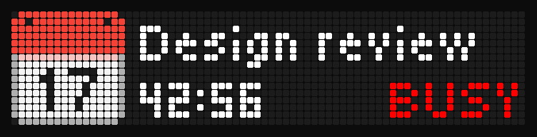
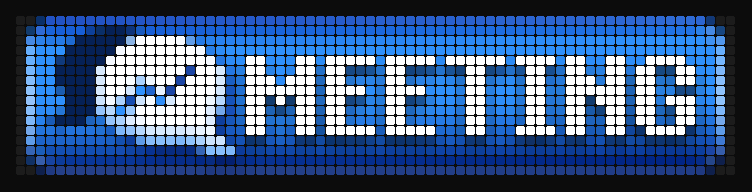
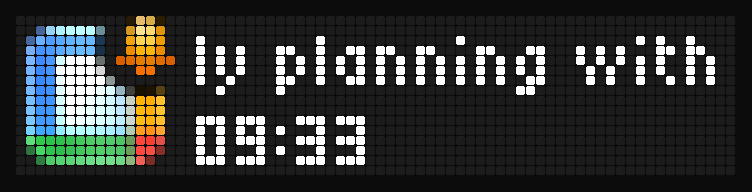
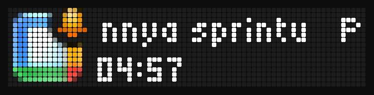
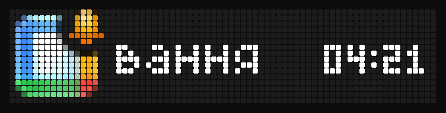
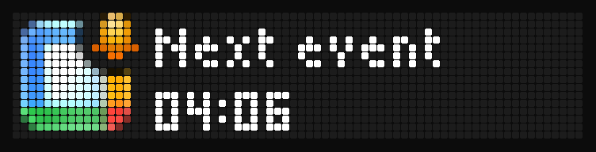

# busybar-calendar

Calendar reminders for the [BUSY Bar](https://busy.app) from **any CalDAV
account or ICS feed**, shown exactly the way the bar shows its built-in
Google Calendar events.



The bar's own [Google Calendar integration](https://docs.busy.app/bar/apps-and-integrations/google-calendar)
runs in BUSY Cloud and only talks to Google. This does the same thing for
iCloud, Fastmail, Nextcloud, PrivateEmail, self-hosted CalDAV servers, and
any calendar published as an ICS link (Outlook, Google, Proton). It runs on
a machine of yours and draws through the bar's
[HTTP API](https://docs.busy.app/bar/dev/http-api), via BUSY Cloud or on the
LAN. The events look the same as Google's; only where they come from is
different. Requested upstream as
[busybar-firmware#1086](https://github.com/busy-app/busybar-firmware/issues/1086).

## On the bar

Every picture here is a frame read back from a real bar (firmware 1.2.4)
through `GET /api/screen`.

| | |
| --- | --- |
| **Before the event** - a red calendar, the title, and a countdown to the start. |  |
| **During the event** - a red calendar, the title, a countdown to the end and a red **BUSY** ... |  |
| ... or one of the bar's own statuses, such as `meeting`, `on_call` or `dnd`. |  |
| **Long titles** scroll beside the icon. |  |
| **Titles in other scripts** are transliterated for the bar's bitmap fonts (`Планування спринту` becomes `Planuvannya sprintu`) ... |  |
| ... or drawn as they are with `title_font = "global"`, on one line beside the countdown. |  |
| **Event name hidden** for a calendar (`show_name = false`). |  |

Like Google events, these go in above an active BUSY session, so they show
on top of any status. A sound plays as a reminder opens and as an event
starts, using the bar's own calendar sounds. After the event, the bar goes
back to whatever it was showing.

## Features

- **CalDAV** with discovery (`/.well-known/caldav`, principal, calendar home),
  or a calendar URL directly; Basic or Digest auth.
- **Calendar filters**: `include` / `exclude` by name, id or URL, with
  wildcards (`exclude = ["Room *"]`).
- **ICS / webcal** feeds, fetched with `If-None-Match`.
- **Recurring events** expanded locally (RRULE, EXDATE, moved occurrences),
  timezones and floating times handled.
- **Google's per-calendar settings** (reminder time, sound, show name,
  status), set once as defaults and overridden per source or per calendar.
- **Overlaps settled by your response**: an event you accepted wins over
  one you marked tentative, which wins over one you have not answered; then,
  as in Google's integration, the newest event wins.
- **Google's filters**: no all-day or 24-hour-plus events. Also skipped:
  cancelled events, events marked free, invitations you declined.
- **On time**: the loop wakes at the next change, not on the next poll.
- **Resilient**: a failing source keeps its last good events; a bar that
  cannot be reached is retried; drawings expire on the bar by themselves
  if the service stops.
- **No secrets in files**: passwords and tokens come from the environment
  or a command such as the macOS Keychain.

## Quick start

### As a BUSY Bar gallery app

`app.py` follows the [community gallery](https://github.com/maxswinkels/busybar-apps)
conventions: one entrypoint, `--host` (default `10.0.4.20`, the bar over
USB), secrets from the environment only.

```sh
pip install -r requirements.txt
python app.py                                   # your calendars after `busybar-calendar init`,
                                                # a demo schedule before
python app.py --host 192.168.1.50 --ics "https://example.com/work.ics"
CALDAV_PASSWORD=... python app.py --caldav https://caldav.icloud.com --user me@icloud.com --include Work
BUSYBAR_TOKEN=... python app.py --cloud --ics "https://example.com/work.ics"   # via BUSY Cloud
python app.py --config config.toml              # every setting
```

`CALDAV_PASSWORD` is the calendar password and `BUSYBAR_TOKEN` the bar's
HTTP API password (or, with `--cloud`, a BUSY Cloud token). A 401 or 404
from the calendar stops the app with an error rather than retrying forever.
The first start after installing the requirements can take several seconds
on macOS, which checks newly installed libraries once (measured: 8.3 s, then
0.15 s on every start after).

### As a service

```sh
git clone https://github.com/kurok/busybar-calendar.git
cd busybar-calendar
uv tool install .            # puts busybar-calendar on your PATH
busybar-calendar init        # a few questions: the bar, the calendar; writes the config
busybar-calendar add         # another calendar later: the same questions, appended
busybar-calendar check       # the bar, its token and every calendar, in one go
busybar-calendar install     # keep it running in the background (launchd / systemd)
busybar-calendar status      # is it running, what did it last do, what is on the bar next
```

`init` asks how to reach the bar (BUSY Cloud, Wi-Fi or USB) and which
calendar to read, stores the passwords in the macOS Keychain (or libsecret
on Linux) with their own prompts, signs in to let you pick calendars, and
writes `~/.config/busybar-calendar/config.toml`. The config is found there
on its own (or in `./config.toml`, or wherever `$BUSYBAR_CALENDAR_CONFIG`
or `-c` points), and you can write it by hand instead. A minimal one:

```toml
[bar]
# A BUSY Cloud token with the "BUSY Bar" access scope, read from the Keychain.
token_command = ["security", "find-generic-password", "-s", "busybar-token", "-w"]

[[sources]]
name = "iCloud"
type = "caldav"
url = "https://caldav.icloud.com"
username = "me@icloud.com"
password_command = ["security", "find-generic-password", "-s", "busybar-icloud", "-w"]
```

More to look at:

```sh
busybar-calendar calendars   # the calendars each CalDAV account has, with ids
busybar-calendar upcoming    # what the bar will show, and when
busybar-calendar demo        # draw a sample reminder for 20 seconds
busybar-calendar replay      # play tomorrow's events on the bar, a minute each
busybar-calendar run         # keep the bar in step with your calendars, in the foreground
```

[docs/setup.md](docs/setup.md) covers connecting the bar (cloud token or LAN
password), the URLs for each calendar provider, storing secrets, and
running it in the background or in Docker.

## Settings

The per-calendar settings are the Google Calendar integration's:

| Google Calendar integration | `config.toml` |
| --- | --- |
| Event reminders: on/off | `reminder.enabled` |
| How long before the event | `reminder.minutes_before` |
| Sound | `reminder.sound` |
| Show event name | `reminder.show_name` |
| Status during events: on/off | `status.enabled` |
| Event name, or a status from the list | `status.show`: `name`, `meeting`, `on_call`, `dnd`, ... |
| Sound | `status.sound` |
| *(not in Google's)* Busy status for events you marked tentative | `status.tentative` (default on) |

They layer: `[defaults]` for every calendar, then per source, then per
calendar (`[sources.calendars."Work".reminder]`). Setting a default once is
the account-level setting BUSY Cloud does not have yet
([busybar-firmware#1083](https://github.com/busy-app/busybar-firmware/issues/1083)).
Every option, with its default, is in the
[configuration reference](docs/configuration.md);
[`config.example.toml`](config.example.toml) shows the common ones together.
`[display]` sets the look: the icons (`event_icon`, `reminder_icon`:
`red_calendar` or the bar's own `animation`) and the word beside the
countdown during an event (`busy_label`, `busy_color`).

## Documentation

- [Setup](docs/setup.md) - the bar, calendar providers, secrets, running as a service, troubleshooting.
- [Configuration reference](docs/configuration.md) - every option and its default, generated from the code.
- [Changelog](CHANGELOG.md) - what changed in each version.
- [How it works](docs/how-it-works.md) - the design, the API calls, and what was measured on the hardware.

## Development

```sh
uv sync
uv run pytest
uv run ruff check . && uv run ruff format --check .
```

`scripts/capture_screens.py` regenerates `docs/images` from a real bar.

## License

MIT, except the red calendar icon in `src/busybar_calendar/icons.py`: it is
redrawn from Google's [Noto Emoji](https://github.com/googlefonts/noto-emoji)
📅 and stays under the SIL Open Font License 1.1
([LICENSES/noto-emoji-OFL.txt](LICENSES/noto-emoji-OFL.txt)).
